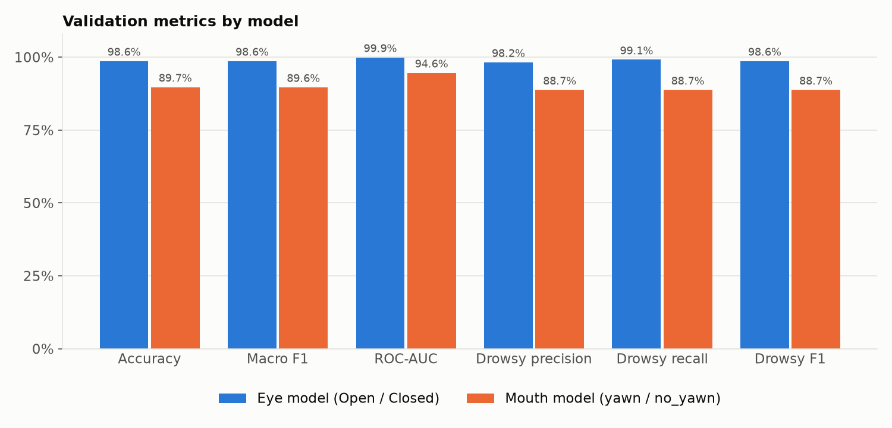
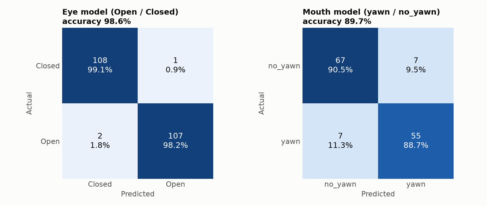
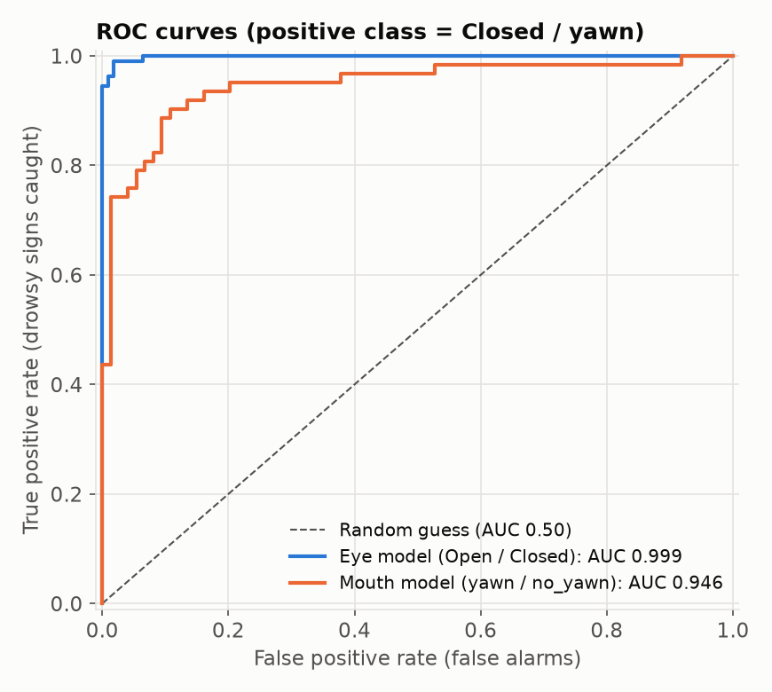

# Driver Drowsiness Detection

Real-time driver fatigue detection from a webcam feed, combining two independent cues:

- **Eye state** (open/closed) via a CNN trained on grayscale eye crops
- **Yawning** (mouth open/closed) via a separate CNN trained on mouth-region crops

Face and eye regions are located with OpenCV Haar cascades; both cues feed into a single
rolling fatigue score, and an alarm sound fires once the score crosses a threshold.

| Model | Accuracy | Macro F1 | ROC-AUC | Drowsy-class recall |
|---|---|---|---|---|
| Eye (Open / Closed) | **98.6%** | 0.986 | 0.999 | 99.1% of closed eyes caught |
| Mouth (yawn / no_yawn) | **89.7%** | 0.896 | 0.946 | 88.7% of yawns caught |

## Quick start

The trained models and alarm sound are committed, so no dataset or training is needed
to run the app.

**Requirements:** Python **3.10–3.12** (TensorFlow does not support newer versions yet)
and a webcam. On macOS: `brew install python@3.12`.

```bash
git clone https://github.com/MujtabaF/driver-drowsiness-detection.git
cd driver-drowsiness-detection
./run.sh
```

The first run creates a `.venv` virtual environment and installs dependencies (a few
minutes); every run after that starts straight away. Commands:

| Command | What it does |
|---|---|
| `./run.sh` | Live webcam drowsiness detection |
| `./run.sh evaluate` | Recompute metrics and charts into `results/` |

A window opens with face/eye boxes, per-cue predictions with confidence are printed to
the console, and a running fatigue score is shown. Once the score passes the threshold
the frame gets a red border and the alarm plays. **Press `q` to quit.**

<details>
<summary>Manual setup (without <code>run.sh</code>)</summary>

```bash
python3.12 -m venv .venv
source .venv/bin/activate
pip install -r requirements.txt

python src/detect.py      # live detection
python src/evaluate.py    # metrics + charts
```

</details>

### Troubleshooting

- **Black window / "Could not open webcam" (macOS)** — grant camera access to the app
  you're running from (Terminal, iTerm, VS Code) in *System Settings → Privacy &
  Security → Camera*, then restart that app.
- **`module 'cv2' has no attribute 'CascadeClassifier'`** — OpenCV 5 removed Haar
  cascades. `requirements.txt` pins `opencv-python<5`; reinstall with
  `pip install -r requirements.txt`.
- **`objc: Class SDL... is implemented in both ...` warnings** — OpenCV and pygame each
  bundle SDL. Harmless noise; ignore it.
- **`No matching distribution found for tensorflow`** — your Python is too new. Delete
  `.venv` and recreate it with Python 3.12.

## Results

Evaluated on the validation split (218 eye images, 136 mouth crops) with
`./run.sh evaluate`. Raw numbers are in [`results/metrics.json`](results/metrics.json).







**Reading the results**

- The **eye model** is near-perfect and balanced: 3 errors in 218 images (1 missed
  closed eye, 2 false alarms).
- The **mouth model** is the weaker cue: 7 missed yawns and 7 false alarms out of 136.
  It also has less training data (826 vs 1,234 images), because face detection fails on
  some of the source photos during mouth-crop preprocessing.
- For an alarm, **recall on the drowsy class** matters most — a missed closed eye is
  worse than an occasional false alarm. Live, the rolling fatigue score smooths out
  single-frame mistakes, so the alarm is more robust than per-image numbers suggest.
- **Caveat:** the validation split was also used by EarlyStopping/ModelCheckpoint to
  pick the best epoch, so these figures are slightly optimistic, and live webcam
  conditions (lighting, glasses, camera angle) differ from the Kaggle images.

## How it works

Two independent binary CNNs rather than one multi-class model, since eyes and mouth come
from different face regions (different cascades) and are conceptually separate signals
that get combined downstream into one fatigue score:

- `eye_model.keras` — 64x64 grayscale eye crop -> Open / Closed
- `mouth_model.keras` — 64x64 RGB mouth-region crop -> yawn / no_yawn

Both are small CNNs (3x Conv2D+MaxPooling blocks, Dropout, Dense head) trained with
data augmentation (flip/rotation/zoom, plus brightness for the mouth model).

The mouth-region crop is taken as the bottom third of the detected face bounding box
(`y + 2h/3` to `y + h`), rather than a separate mouth cascade — OpenCV doesn't ship a
reliable one, and this keeps training and live inference using the exact same crop logic.

**Fatigue score** (`src/detect.py`): each frame adds +1 if eyes are closed, else +2 if a
yawn is detected, else −1, clamped to 0–30. The alarm fires above 15, so a single
misclassified frame never triggers it — only sustained signs of drowsiness do.

### Project layout

```
├── run.sh                    # one-command launcher
├── alarm.wav                 # alarm sound (regenerate with src/generate_alarm.py)
├── models/                   # trained .keras models + class-index maps
├── results/                  # metrics.json + evaluation charts
├── src/
│   ├── detect.py             # live webcam detection + alarm
│   ├── evaluate.py           # accuracy / precision / recall / F1 / ROC-AUC
│   ├── plot_metrics.py       # charts from results/metrics.json
│   ├── preprocess_mouth.py   # crops mouth regions from full-face images
│   ├── train_eye_model.py
│   ├── train_mouth_model.py
│   └── generate_alarm.py     # synthesizes alarm.wav
└── understanding.md          # design decisions + debugging writeup
```

## Retraining from scratch (optional)

Only needed to retrain the models or re-run evaluation; the dataset is not committed.

### 1. Dataset

Download the "yawn eye dataset new" dataset from Kaggle (search for that name, or
"Driver Drowsiness Dataset"). It ships as `archive.zip` with this structure:
`dataset_new/{train,test}/{Open,Closed,yawn,no_yawn}/`.

Extract eyes directly (already tightly cropped) and rename `test` -> `valid`:

```bash
unzip -j archive.zip 'dataset_new/train/Open/*'   -d dataset/eyes/train/Open
unzip -j archive.zip 'dataset_new/train/Closed/*' -d dataset/eyes/train/Closed
unzip -j archive.zip 'dataset_new/test/Open/*'    -d dataset/eyes/valid/Open
unzip -j archive.zip 'dataset_new/test/Closed/*'  -d dataset/eyes/valid/Closed

unzip -j archive.zip 'dataset_new/train/yawn/*'    -d dataset/mouth/train/yawn
unzip -j archive.zip 'dataset_new/train/no_yawn/*' -d dataset/mouth/train/no_yawn
unzip -j archive.zip 'dataset_new/test/yawn/*'     -d dataset/mouth/valid/yawn
unzip -j archive.zip 'dataset_new/test/no_yawn/*'  -d dataset/mouth/valid/no_yawn
```

The `yawn`/`no_yawn` images are full face frames, not mouth crops, so they need
preprocessing (crops the bottom-third-of-face mouth region using face detection,
matching what happens at inference time):

```bash
python src/preprocess_mouth.py
```

### 2. Train, evaluate, run

```bash
python src/train_eye_model.py     # -> models/eye_model.keras + eye_classes.json
python src/train_mouth_model.py   # -> models/mouth_model.keras + mouth_classes.json
python src/evaluate.py            # -> results/metrics.json + charts
python src/detect.py
```

`python src/generate_alarm.py` re-synthesizes `alarm.wav` (a two-tone alert) if needed.

## Key engineering decisions (and bugs caught along the way)

- **Face-detect + bottom-third crop for mouth, instead of a dedicated mouth cascade** —
  OpenCV's bundled `haarcascade_smile.xml` is tuned for smile shape, not open-mouth
  yawns, and is unreliable. Reusing the already-detected face box keeps one consistent
  pipeline and guarantees training/inference use identical crop logic.
- **`minSize` filtering on Haar cascade detections** — loosening `scaleFactor`/
  `minNeighbors` to reduce missed detections also let through spurious tiny "face"
  boxes (as small as 24px) that don't correspond to a real face. Left unfiltered,
  these silently corrupted training data (garbage crops with correct folder labels)
  and were traced by inspecting the actual detected box-size distribution rather than
  assuming the miss/skip counts alone told the full story.
- **Augmentation ordering bug** — `RandomBrightness` defaults to assuming `[0, 255]`
  input, but was being applied after `Rescaling(1/255)` had already normalized to
  `[0, 1]`, blowing pixel values up to ~18 and collapsing the mouth model to
  constant-class predictions (~50% val accuracy, identical every epoch). Fixed by
  running brightness augmentation before normalization.
- **BGR vs RGB channel-order mismatch at inference** — training images were written
  to disk via `cv2.imwrite` (converts to true RGB in the file) and read back as RGB
  by Keras, but live webcam frames from `cv2.VideoCapture` are BGR. Feeding raw BGR
  frames to the mouth model caused it to confidently (90-100%) misclassify almost
  every frame as "yawn." Root-caused by adding per-frame confidence logging rather
  than trusting the aggregate alarm output, then fixed with an explicit
  `cv2.cvtColor(..., cv2.COLOR_BGR2RGB)` before inference.
